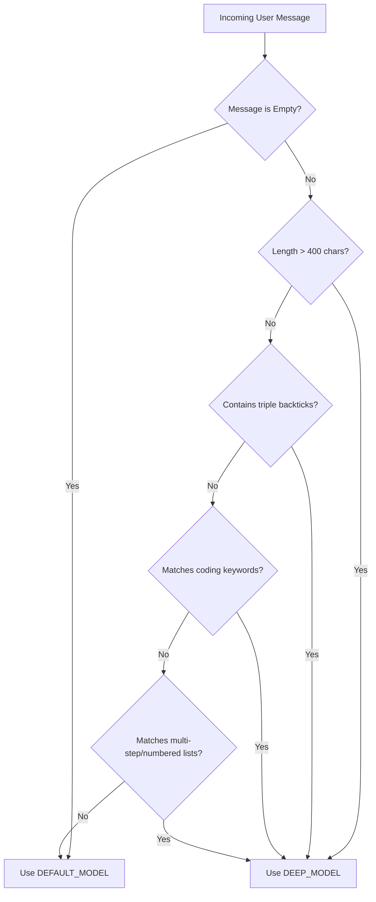

# Dual-Model Router (`model_router.py`)

A smart, rule-based routing module designed for the Telegram AI Agent. It dynamically classifies incoming user queries to select the most appropriate LLM: a lightweight, fast model for general conversations, or a deep reasoning model for complex or code-heavy tasks.

---

## Table of Contents
1. [Overview](#overview)
2. [Why Dual-Model Routing?](#why-dual-model-routing)
3. [Routing Rules & Heuristics](#routing-rules--heuristics)
4. [Integration & Usage](#integration--usage)
5. [Configuration](#configuration)
6. [Examples](#examples)
7. [Visual Decision Flow](#visual-decision-flow)

---

## Overview

The [`model_router.py`](file:///Users/sharofiddin/Desktop/aiagent/utils/model_router.py) module exports the core helper function `should_use_deep_model(message_text: str) -> bool`. 

This function acts as a gatekeeper, parsing the user's prompt using highly optimized, zero-latency regular expressions and keyword checks to determine if the query warrants a transition to the deep reasoning model.

---

## Why Dual-Model Routing?

* **Resource & Cost Optimization:** Conversational queries (e.g., *"Hello! How are you?"*) are handled by a smaller, fast model (`qwen3:8b`), reducing compute overhead and response latency.
* **Intelligent Escalation:** Coding, debugging, and multi-step reasoning tasks are automatically upgraded to a larger model (`gpt-oss:20b`) where correctness is crucial.
* **Fluid User Experience:** The agent handles transitions transparently, alerting the user via Telegram only when switching between models.

---

## Routing Rules & Heuristics

A query is routed to the **Deep Model** if it satisfies *any* of the following conditions:

| Category | Heuristic / Trigger Rule | Technical Implementation / Example |
| :--- | :--- | :--- |
| **1. Length** | Prompt length exceeds `400` characters | `len(message_text) > 400` |
| **2. Code Blocks** | Contains Markdown code fences | Detects occurrence of ` ``` ` |
| **3. Coding Keywords** | Exact match of programming/debugging terminology | Tokenized word-list intersection (e.g., `debug`, `refactor`, `traceback`, `pointer`, `memory leak`, `recursion`) |
| **4. Structural Intent** | Contains explicit phrases indicating step-by-step or list requests | Phrases like `step-by-step`, `multi-step`, or a numbered list pattern matching `\b\d+\.\s` (e.g., `1. `, `2. `) |

---

## Integration & Usage

### 1. Model Switching in `main.py`
The telegram bot checks each incoming message through `should_use_deep_model`. If the model switches, the bot posts a notice to the user:

```python
target_model = settings.DEEP_MODEL if should_use_deep_model(text) else settings.DEFAULT_MODEL

last_model = await history_db.get_last_model(chat_id)
prev_model = last_model or settings.DEFAULT_MODEL

if prev_model != target_model:
    icon = "🧠" if target_model == settings.DEEP_MODEL else "⚡"
    model_name = "deep reasoning model" if target_model == settings.DEEP_MODEL else "fast conversational model"
    await context.bot.send_message(
        chat_id=chat_id,
        text=f"{icon} Switching to the {model_name} (`{target_model}`), this may take a few extra seconds to load..."
    )
```

---

## Configuration

The defaults are controlled by the central configuration class `Settings` inside [`config.py`](file:///Users/sharofiddin/Desktop/aiagent/config.py):

* **`DEFAULT_MODEL`**: The fast conversational model. (Default: `qwen3:8b`)
* **`DEEP_MODEL`**: The high-capacity reasoning model. (Default: `gpt-oss:20b`)

These settings can be overridden at runtime using environment variables:
```bash
DEFAULT_MODEL="qwen3:8b"
DEEP_MODEL="gpt-oss:20b"
```

---

## Examples

### ⚡ Fast Model Triggers (`DEFAULT_MODEL`)
* *"How is the weather in Tokyo?"*
* *"Write a short joke about a programmer."*
* *"What is 25 * 4?"*

### 🧠 Deep Model Triggers (`DEEP_MODEL`)
* **Code Block:**
  ```text
  Fix the error in this code:
  ```python
  def run():
      print(x)
  ```
  ```
* **Keyword Match:** *"I'm experiencing a **memory leak** in my Node.js application."*
* **Multi-step Intent:** *"Give me a **step-by-step** explanation of how OAuth2 works."*
* **Numbered List:** *"How do I bake a cake? 1. Mix ingredients..."*

---

## Visual Decision Flow


